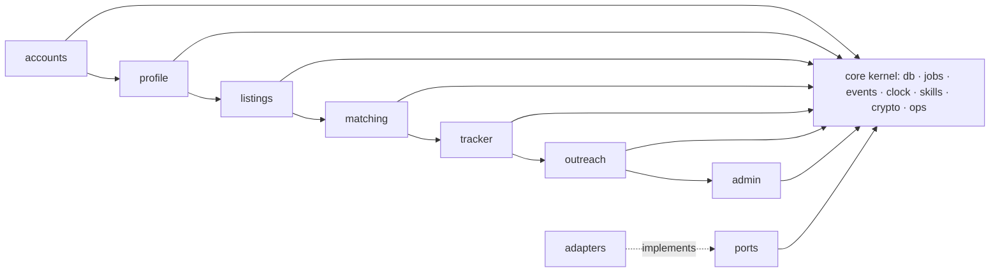
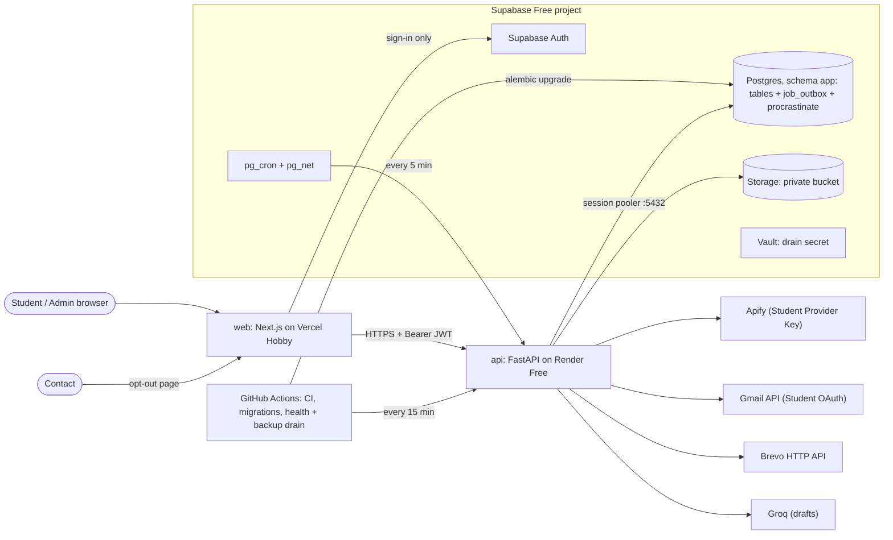
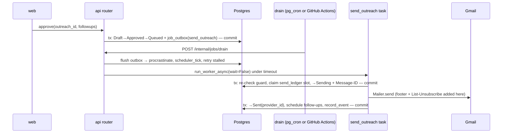
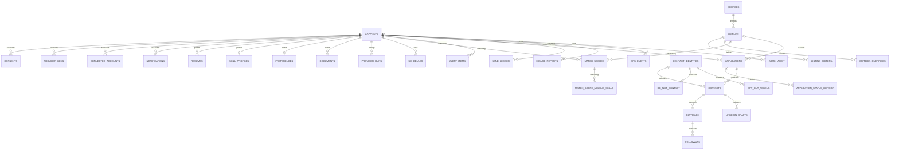

# Architecture Spine: CareerLaunch

## Design Paradigm

**Modular monolith with ports and adapters.** One FastAPI service (`api/`) holds all business logic, split into seven modules. Each module has the layers `router → service → repository`, and calls the outside world only through **ports** implemented by **adapters**. Next.js (`web/`) is a UI only. Supabase Postgres is the single store, and a Postgres-backed job queue carries all work done outside requests.

| Layer | Lives in | May depend on |
| --- | --- | --- |
| Router (HTTP, auth context, DTOs, opens and commits the unit of work) | `api/app/modules/<m>/router.py` | own service |
| Task (job entry point, opens and commits the unit of work) | `api/app/modules/<m>/tasks.py` | own service |
| Service (rules, state machines; takes the session, never commits) | `api/app/modules/<m>/service.py` | own repository, services of modules **to its left** (AD-20), `core`, ports |
| Repository (SQL for own tables) | `api/app/modules/<m>/repo.py` | own tables only (plus the allowed reads in AD-2) |
| Ports | `api/app/ports/` | `core` types only |
| Adapters | `api/app/adapters/<vendor>/` | ports, vendor SDKs |
| Core kernel | `api/app/core/` (db, auth, crypto, errors, events, jobs, clock, skills, ops) | nothing in `modules/` |

## Invariants & Rules



Arrows read "may be called by". Each module may call the services of modules to its left, never to its right. Calls in the reverse direction go through domain events (AD-20).

### AD-1: FastAPI is the single data gateway [ADOPTED]

- **Binds:** all; FR-1, §5 Security
- **Prevents:** rules (ownership, caps, do-not-contact, status transitions) enforced in one app and skipped in another; data reachable with the public key.
- **Rule:** Only `api` connects to Postgres or Storage with privileged credentials. `web` calls only the FastAPI API through the generated client (AD-14), and uses Supabase only for Auth. **Every table (app and Procrastinate) lives in the Postgres schema `app`, which is not exposed by the Supabase Data API.** Every table has RLS enabled, and `anon`/`authenticated` have no grants on it. A CI check fails if any table exists in an exposed schema.

### AD-2: Each module owns its tables [ADOPTED]

- **Binds:** all modules
- **Prevents:** two modules writing one entity with different rules; hidden coupling through shared tables.
- **Rule:** Every table has one owning module (see the ERD). Only that module's repository writes it. Cross-module SQL reads are allowed **only** in these places: `matching.repo` reads `listings`, `listing_criteria` (feed); `listings.repo` reads `match_scores` (search ranking). Every other cross-module access is a service call. Each foreign key into another module's table declares its `ON DELETE` action in the migration, as listed in AD-7 and AD-19.

### AD-3: External systems sit behind ports [ADOPTED]

- **Binds:** FR-6, FR-7, FR-18, FR-19, FR-21, FR-22, FR-23, FR-26, FR-28; FR-11, FR-15
- **Prevents:** vendor SDKs leaking into domain code; untestable flows; a Source swap touching matching, Tracker or Outreach; Pool and manual Listings having different shapes.
- **Rule:** Only `adapters/` imports vendor SDKs, and import-linter enforces this in CI. The ports are `SourceAdapter`, `ProviderRunner`, `Mailer`, `Notifier`, `Drafter`, `FileStore`, `AuthAdmin`, and `Embedder` (reserved). Each has an in-memory fake in `api/tests/fakes/`. `SourceAdapter` yields `ListingDraft` (a Pydantic model in `ports/`: `source, source_job_id, url, title, company_raw, location_raw, job_type, description, posted_at: datetime|None, deadline: date|None`). Raw provider output is mapped to it and never stored. Manual Listings (FR-18) are built as a `ListingDraft` and go through the same `listings.service.ingest_draft()` pipeline (trim, skill extraction, criteria extraction). Their URL is stored and never fetched server-side. Adapters that refresh credentials return a `CredentialUpdate`, which the calling service persists through `accounts.service.store_credential()`.

### AD-4: All background work is a durable job [ADOPTED]

- **Binds:** FR-6, FR-8, FR-9, FR-11, FR-15, FR-20 to FR-24, FR-27; §5 Reliability, Hosting
- **Prevents:** lost or duplicate side effects on a host that sleeps; jobs committed without their state change; mixed scheduling mechanisms.
- **Rule:**
  1. **Enqueue:** services enqueue only through `core.jobs.enqueue(session, task, key, run_at=None, queue="default", **ids)`. It inserts a `job_outbox` row in the caller's transaction. The drain moves outbox rows into Procrastinate. Calling Procrastinate `defer` in `modules/` is forbidden by a lint rule.
  2. **Arguments and keys:** job arguments are **ids only, never personal data or secrets**. The key format is `<module>.<task>:<entity_type>:<entity_id>[:<scope>]`, using the most specific entity, with `scope` as a local date or attempt. Key-based dedup protects DB effects only. External side effects use the commit-before-call state (AD-10, AD-12).
  3. **Recurring work:** recurring work never uses `@app.periodic`. `core.jobs.scheduler_tick` runs at the start of each drain. It reads `schedules(kind, owner_id, next_run_at, paused)`, enqueues the jobs that are due, and advances `next_run_at`. Pausing a Source or provider pauses its schedule rows, so the pause takes effect by the next tick.
  4. **Triggers:** the drain is `POST /internal/jobs/drain`. Supabase `pg_cron` calls it every 5 minutes via `pg_net` with `timeout_milliseconds` of at least 90000. A GitHub Actions workflow calls `GET /internal/health` every 15 minutes and drains as a backup. Health returns 503 when `last_drain_at` is more than 15 minutes old, which fails the workflow and alerts the owner. The drain secret lives in Supabase Vault and Render env, is compared in constant time, and accepts two values during rotation.
  5. **The drain itself:** each drain flushes the outbox, runs `scheduler_tick`, re-queues stalled jobs (Procrastinate `get_stalled_jobs` → `retry_job`), then runs `run_worker_async(wait=False)` under an asyncio timeout of at most 4 minutes. It processes the `priority` queue before `default`.
  6. **Priority path:** after committing a Student-initiated change that needs fresh scores (onboarding, a Resume, Skill Profile or Preferences change), the router starts an in-process bounded drain of the `priority` queue as a post-response background task.
  7. **Retries:** the default policy is exponential backoff, up to 5 attempts. Tasks with external side effects override it (AD-10, AD-12).

### AD-5: Identity, roles and actor scoping [ADOPTED]

- **Binds:** FR-1, FR-2, FR-27
- **Prevents:** IDOR (one Student reading another's records by guessing an id); admins reading private Student content; role checks done only in the UI; global entities that end up owned by whoever touched them.
- **Rule:**
  - **Identity and role:** `accounts.id` is the Supabase Auth user id. FastAPI verifies the Supabase JWT (signature, `aud`, `exp`) on every request and loads `role` (`student` | `admin`) from `accounts`, never from client claims. Admins are created only by a CLI script, and no API grants the role.
  - **Student-owned data:** every Student-owned table, children included, has a non-null `owner_id`, and every repository method takes it from the auth context or the job's entity row.
  - **Global tables:** these have no `owner_id`: `sources`, `listings` (pool rows), `contact_identities`, `do_not_contact`, `misuse_reports`, `ops_events`, `admin_audit`. Their service functions take an `actor` (Student | Admin | System). Admin actors are audited.
  - **Admin limits:** admin routes sit under `/api/v1/admin/*`. No admin service returns Resume, Document, Outreach body, Provider Key or token data.

### AD-6: Secrets and connected accounts [ADOPTED]

- **Binds:** FR-19, FR-28; §5 Security
- **Prevents:** secrets readable in the DB, logs or API; forged or replayed OAuth connects; a Gmail connection that silently dies.
- **Rule:**
  - **Encryption:** Provider Keys and OAuth tokens are stored only as AES-GCM ciphertext from `core.crypto`, with additional authenticated data `table:row_id:owner_id` and a key-version prefix. The master key lives in Render env, with an offline copy in the owner's password manager, never in the DB or repo. Secrets are decrypted only inside the adapter that uses them. APIs expose only `has_key` and a last-4 hint, and log formatters redact them.
  - **Gmail connect:** this is a FastAPI-owned OAuth code flow (`/api/v1/oauth/google/start|callback`, `state` + PKCE, offline access, `gmail.send` only), separate from Supabase sign-in.
  - **Expiry and revocation:** an `invalid_grant` marks the connection `expired`, holds queued sends in Queued, and notifies the Student to reconnect. While the Google app is in Testing mode, refresh tokens expire after 7 days. Disconnecting or deleting the account revokes the grant at Google and then deletes the ciphertext.

### AD-7: Shared Listing pool, deadlines and eviction [ADOPTED]

- **Binds:** FR-6, FR-8, FR-15, FR-17, FR-18; §5 Data model, Storage budget
- **Prevents:** duplicate Listings; manual Listings leaking into the pool; the Tracker breaking on eviction; reminders firing on stale deadlines.
- **Rule:**
  - **Ownership and dedup:** `listings` owns Listings. Pool Listings are unique on `(source, source_job_id)` (DB constraint, upsert on conflict). Manual Listings have `source='manual'` and an `owner_id`, and are visible only to that owner.
  - **Minimal pool content [ADOPTED]:** a pool Listing's description is used only during ingestion, then discarded. Ingestion extracts skills (AD-8), criteria with snippets of 200 characters or less (AD-21), and a `search_doc` tsvector (lexemes only), then drops the text. Pool rows keep only title, company, location, job type, dates, source URL, skills, criteria, `search_doc`, and `collected_by` (the Student whose key collected it; SET NULL on deletion). Only manual Listings keep a description, private to their owner (4,000 characters or less).
  - **Attribution and takedown:** the UI shows the source and a not-affiliated notice on every pool Listing, and "apply" links to the source URL. Admins can block a Listing, URL or company through `listings.service.block()` (audited). Blocked keys are never re-ingested.
  - **Pinning:** `tracker` calls `listings.service.pin(listing_id)` / `unpin()` when an Application is created or deleted. Eviction never removes a pinned Listing.
  - **Relevance and eviction:** `matching` calls `listings.service.set_relevance(listing_id, max_score)`. Expiry, the 30-day grace period and cap eviction are `listings` jobs that rank by age and relevance and take `FOR UPDATE SKIP LOCKED` on candidate rows.
  - **Delete actions:** foreign keys into `listings` use CASCADE for `match_scores`, `match_score_missing_skills`, `alert_items`, `criteria_overrides` and `listing_criteria`, and SET NULL for `applications.listing_id`.
  - **Snapshots and deadlines:** `applications` snapshot title, company, url and deadline when created. The snapshot is read only when the Listing is gone. While the Listing exists, the deadline is `listings.service.effective_deadline(owner_id, listing_id)` (override > extracted > source). A deadline change publishes `DeadlineChanged`.

### AD-8: One skill vocabulary and normaliser

- **Binds:** FR-4, FR-9, FR-12, FR-29
- **Prevents:** Resume skills and JD skills normalized differently; comparing across vocabulary versions; Student edits lost on re-extraction.
- **Rule:**
  - **Vocabulary:** `core.skills` holds the versioned canonical vocabulary and `normalize(text) -> set[skill_id]`. A `skill_id` is a stable lower-kebab slug that is never reused, and renames are handled as aliases. `profile` and `listings` both call it, and nobody keeps their own alias table.
  - **Versioning:** every stored skill set records `vocab_version`. A vocabulary bump enqueues re-extraction, and `score()` re-normalises older-version inputs through the alias map.
  - **Student edits:** these are stored as `added` / `removed` sets applied over the extracted set, so they survive re-uploads until the Student resets them. Custom skills outside the vocabulary are stored but not scored in v1.

### AD-9: Match Score contract [ADOPTED]

- **Binds:** FR-9, FR-10, FR-11, FR-12, FR-13
- **Prevents:** scores that can't be reproduced; feed, alerts and insights computing scores differently; stale scores after edits; the DB quota blown by scoring everything.
- **Rule:**
  - **One scorer:** only `matching` computes or writes scores, through the pure function `score(profile, listing, weights) -> (0..100, ScoreBreakdown)`. It uses weighted canonical-skill overlap plus Postgres lexical similarity on the title and `search_doc`, with no embeddings and no LLM.
  - **Breakdown shape:** `ScoreBreakdown` is a Pydantic model exposed in OpenAPI: `algo_version, weights_version, vocab_version, matched_skills[], missing_skills[], components[{name, points, max_points}]`. Missing skills are also written to `match_score_missing_skills` for FR-12.
  - **Stored set:** scores are stored only for each Student's candidate set (pool Listings passing role, location and job type, capped at 500) and their manual Listings. Eligibility never excludes Listings from the candidate set. Search results outside the set, and a new Student's feed before the first recompute, are scored on request with the same function and not stored.
  - **Recompute:** the only trigger is `matching.service.mark_stale(owner_id | listing_ids, reason)`, called from events. It sets `scores_stale_since`. The recompute job (`matching.recompute:student:<id>`, `priority` queue for Student-initiated changes) runs again if staleness is newer than its start. New Listings are scored in batches per ingestion run.
  - **Ordering:** ties sort by `posted_at` descending, then `first_seen_at`.

### AD-10: Outreach state machine and send guard [ADOPTED]

- **Binds:** FR-2, FR-20 to FR-25; §8 Anti-spam
- **Prevents:** a send from a non-Approved state; duplicate emails after a crash; cap races; sends that skip do-not-contact; follow-ups that outlive their reason; a footer the Student can delete.
- **Rule:**
  - **States:** Outreach and Follow-up states change only through `outreach.service.transition()`: Draft → Approved → Queued → Sending → Sent → Replied, plus Failed and Cancelled. Cancelled is reachable from any state before Sending. Editing an Approved draft returns it to Draft. LinkedIn drafts (FR-25) are a separate entity with no send states.
  - **Before sending:** only `outreach.send_outreach` calls `Mailer`. In one transaction it re-checks consent, `is_blocked()` (AD-19), Student outreach suspension, the connection status, the Application status (via `tracker.service`), and email confidence confirmation. It claims a cap slot by inserting `send_ledger(owner_id, local_day, slot)` (unique, slots 1–20) and checking that the Application's sends are under 3. It then moves the item to Sending with a generated `Message-ID` and commits.
  - **Sending:** it calls `Mailer` outside the transaction, then commits Sent with the provider message id.
  - **Failure handling:** a retry that finds Sending without a provider id becomes Failed (delivery unknown) and is never resent automatically. A synchronous rejection becomes Failed, with at most one retry. If the cap is full, the item is rescheduled to 09:00 local the next day.
  - **Footer:** the opt-out footer (opt-out link and sender identity) and the `List-Unsubscribe` / `List-Unsubscribe-Post` headers are added by the send task, never kept in the editable body. Emails are plain text.
  - **Bounces:** asynchronous bounces are not detected (`gmail.send` only). The Student can mark an item Bounced, and it is shown as Failed.
  - **Follow-ups:** these are approved with their Outreach, but scheduled when the parent reaches Sent (day 5 and day 10 from the actual send). `ApplicationClosed`, a reply, or a do-not-contact entry cancels them in the same transaction.

### AD-11: Consent is one gate

- **Binds:** FR-2, FR-19, FR-20, FR-22, FR-28
- **Prevents:** a feature that forgets to check consent, or checks a different flag; jobs orphaned when consent is revoked.
- **Rule:** `accounts` owns timestamped, versioned consent records per purpose: `provider_runs`, `pool_contribution`, `linkedin_link`, `outreach`, `llm_drafting`. Without `pool_contribution`, a Student's collected Listings stay visible only to them. Modules call `accounts.service.require_consent(owner_id, purpose)` when they enqueue a job and again inside the job. Revoking consent publishes `ConsentRevoked(owner_id, purpose)`. Each owning module moves its own entities to Cancelled or Paused in that transaction. No module touches Procrastinate tables except `core.jobs`.

### AD-12: All Apify spend goes through one runner

- **Binds:** FR-6, FR-20, FR-21, FR-27, FR-28
- **Prevents:** runs launched over the cap; double-paid runs after a retry; long runs blocking a worker; a pause that covers only part of the spend.
- **Rule:**
  - **Single path:** `listings.service.start_provider_run(owner_id, purpose, params)` owns `provider_runs` and is the only caller of `ProviderRunner`.
  - **Scoped keys:** Students are told to create a **scoped Apify token** (Run permission on the approved actors only, restricted access, with an expiry). It is validated with `GET /v2/users/me` when saved. Every request sends the `x-apify-integration-platform` header, and every run sets a max charge and max items. Actors are allowlisted in config, and cookie or login inputs are never set.
  - **Before starting:** it checks the per-Student `provider_status` (owned by `accounts`, covering all purposes), Source and provider enablement, and the per-run, monthly and platform caps. It commits `provider_runs` as `starting`, then starts the Apify run asynchronously and stores the run id. It never starts again if a run id exists.
  - **Results:** a `listings.poll_provider_run` job (backoff) collects results and actual cost. No task waits synchronously on Apify.
  - **Failures:** auth or credit errors set `provider_status=paused` with the reason, which the Student sees. Credit exhaustion sets `exhausted_until` (the next billing cycle), and the shared pool keeps serving that Student.
  - **Triggers:** saving a valid key enqueues a first ingestion run. The seed run uses the owner key from env.

### AD-13: Alembic owns the schema; migrations run before deploys [ADOPTED]

- **Binds:** all; §5 Data model
- **Prevents:** schema drift; vendor schemas outside the security rules; a deploy that breaks the running API or web.
- **Rule:**
  - **What Alembic covers:** every DDL change is an Alembic migration in `api/migrations/`, and nobody edits schema in the dashboard. That includes the Procrastinate schema and its upgrades (vendor SQL wrapped in a migration, with `search_path=app`), extension enablement, the `pg_cron` schedule, RLS and grant revocation. `supabase/` keeps CLI config only.
  - **Integrity in the DB:** foreign keys, the unique constraints named in the ADs, check constraints (scores and threshold 0–100, enum states), and status-history rows written in the same transaction.
  - **Running migrations:** prod migrations run from GitHub Actions through the session pooler before the Render deploy hook fires. Migrations are expand-then-contract, so the previous API and web keep working.

### AD-14: OpenAPI is the API contract [ADOPTED]

- **Binds:** web ↔ api
- **Prevents:** frontend and backend types drifting apart; endpoint-specific error shapes; ad-hoc auth for public routes.
- **Rule:**
  - **Generated client:** the FastAPI OpenAPI schema is the contract. `web/src/api/` is generated by `@hey-api/openapi-ts`, and CI fails if regenerating it changes anything.
  - **Errors and lists:** errors are RFC 9457 `application/problem+json` with a stable `type`. Lists use cursor pagination (`items`, `next_cursor`).
  - **Route classes:** `/api/v1/*` requires a Student JWT; `/api/v1/admin/*` requires the admin role; `/api/v1/public/*` is token-scoped or unauthenticated and rate-limited (opt-out, misuse report); `/api/v1/oauth/*` handles callbacks; `/internal/*` is secret-protected and not in the public schema.
  - **Browser auth:** `web` holds the Supabase session in cookies (`@supabase/ssr`) and sends `Authorization: Bearer` to `api`. `api` uses no cookies, and its CORS allows only the Vercel origin and localhost.

### AD-15: Drafter guardrails [ADOPTED]

- **Binds:** FR-22, FR-25; §5 Tone, Privacy
- **Prevents:** invented experience; third-party data sent to an LLM; prompt injection from scraped text becoming email; drafting failing when free quotas run out.
- **Rule:**
  - **Input:** the `Drafter` gets only confirmed Skill Profile facts, the Listing's title, company and extracted skills (passed as delimited, untrusted data), and the Contact's **role**. It never gets the Contact's name or email. Names are placeholders filled in locally.
  - **Validation:** output is validated (plain text, under 150 words, names company and Listing, no URLs or email addresses other than those placeholders) before it becomes a Draft.
  - **Fallback:** on a provider error, a rate limit, failed validation, or no `llm_drafting` consent, the deterministic template drafter is used.
  - **Provider choice:** the provider and model are pinned in config. The consent text names the provider and states that free-tier inputs may be used for training.

### AD-16: Notifications [ADOPTED]

- **Binds:** FR-11, FR-15
- **Prevents:** platform notices sent from Student mailboxes; one email per Listing instead of a digest; repeat alerts; stale reminders.
- **Rule:**
  - **Alert eligibility:** `matching` owns `alert_items(owner_id, listing_id)`, which is unique. A Listing becomes alert-eligible when its stored score first crosses the threshold and its `first_seen_at` is within 7 days.
  - **Messages:** `accounts` owns `notifications(owner_id, kind, dedup_key)` (unique, one row per message, `dedup_key` like `digest:<local_date>` or `reminder:<application_id>:<deadline>`) and calls `Notifier`, which uses Brevo's HTTP API. The email is an `accounts.send_notification` job enqueued in the row's transaction. Digests are built by `matching` and sent at a fixed local hour.
  - **Reminders:** reminders are scheduled by `tracker` and rescheduled on `DeadlineChanged`. At send time, the job re-checks the Application status and the effective deadline.

### AD-17: Retention, deletion and quota are jobs

- **Binds:** FR-2, FR-8, FR-26; §5 Privacy, Storage budget
- **Prevents:** data outliving its purpose; partial account deletion; the 0.5 GB quota filled by derived data.
- **Rule:**
  - **Account deletion:** one transaction cascades DB rows, cancels the Student's entities through events, and enqueues `purge_files`, `revoke_google` and `AuthAdmin.delete_user` jobs.
  - **What survives:** global rows (AD-19, `ops_events`, `admin_audit`) keep no Student personal data, and their Student foreign keys are SET NULL.
  - **Contact data:** only `name, role, company, linkedin_url, email, email_confidence, discovered_at` is stored. Personal fields are cleared 90 days after the later of discovery and last Outreach activity, and the hashed identity is kept.
  - **Purges:** finished Procrastinate jobs and outbox rows are purged after 7 days, `ops_events` after 90 days, and expired Listings per AD-7. An `admin` job alerts at 80% of the DB quota.

### AD-18: Operational log, audit and abuse controls

- **Binds:** FR-6, FR-23, FR-27; §5 Observability; §8 Anti-spam
- **Prevents:** runs and sends logged in different formats; admin actions without a trail; a Student using the platform to spam with no way to stop it.
- **Rule:**
  - **Logging and audit:** `core.ops` owns `ops_events` (append-only, ids and counts only, no personal data or bodies) and `admin_audit` (insert-only, no update or delete grant). Every module writes through `core.ops.record_event()` and `record_audit()`. `admin` reads both.
  - **Misuse reports:** `outreach` owns `misuse_reports`, filed through the public opt-out page or by Students.
  - **Suspension:** Admins can set `outreach_suspended` on an account (owned by `accounts`, checked by the send guard), and the action is audited. Each Student's opt-out rate (SM-C1) is shown to Admins.

### AD-19: Contact identity and do-not-contact are global

- **Binds:** FR-20, FR-21, FR-23, FR-27; §5 Privacy
- **Prevents:** an opted-out person emailed by another Student; do-not-contact or opt-out links lost to cascades or purges.
- **Rule:**
  - **Identity:** `outreach` owns `contact_identities`, global and keyed by HMAC-SHA256 (secret pepper in env) of the normalized email and, separately, of the canonical LinkedIn URL. Per-Student `contacts` reference it.
  - **Do-not-contact:** `do_not_contact` keys on `contact_identity_id`. It is exempt from account cascade and the 90-day purge.
  - **The one check:** `outreach.service.is_blocked(email|linkedin_url)` is the only check. Discovery, lookup, the send guard and admin all call it.
  - **No pooling of people data:** Discovery and email-lookup results are per-owner. They are never shared with or reused for another Student, and `contact_identities` hold only hashes, never names or emails.
  - **Opt-out tokens:** 32 random bytes, stored hashed, resolving to the identity, never expiring while the identity exists. The link opens a Vercel page that confirms by `POST /api/v1/public/opt-out`, so mail scanners that prefetch the link don't trigger it, and a repeat click succeeds without changing anything. A new block cancels queued Outreach to that identity across all Students.

### AD-20: Module order and unit of work

- **Binds:** all modules
- **Prevents:** circular service imports; a status change and its consequences committed separately.
- **Rule:**
  - **Module order:** the order is `accounts ← profile ← listings ← matching ← tracker ← outreach ← admin`. A service may call only services of modules to its left, and import-linter enforces this in CI.
  - **Events:** reverse-direction effects are typed domain events in `core.events`, published inside the caller's session. Subscribers run synchronously in the same transaction before commit. The events are `ResumeActivated`, `SkillProfileChanged`, `PreferencesChanged`, `ListingsIngested`, `DeadlineChanged`, `ApplicationClosed`, `ApplicationReopened`, `ConsentRevoked`, `AccountDeleting` and `ContactBlocked`.
  - **Commits:** only routers and tasks commit.
  - **Application status:** `tracker.service.transition()` is the only writer, using an explicit transition table. "Applied or later" (Applied, Interview, Offer) unlocks Discovery. Entering Rejected or Withdrawn publishes `ApplicationClosed`. Reopening does not revive cancelled Follow-ups.

### AD-21: One eligibility evaluator

- **Binds:** FR-5, FR-14, FR-29
- **Prevents:** feed, search and detail views computing Eligible / Not eligible / Unknown differently.
- **Rule:**
  - **The evaluator:** `listings.service.evaluate_eligibility(owner_id, listing_ids) -> {id: (Eligible|NotEligible|Unknown, conflicts[])}` is the only evaluator. It applies the Student's `criteria_overrides` and reads Student attributes through `profile.service`.
  - **Stored criteria:** criteria are typed: `kind` enum, `cgpa_min` normalized to a 10-point decimal with the raw value kept, `batch_years int4range`, canonical `degree` plus raw, and `work_auth`. Each keeps its `source_snippet`, and anything that can't be extracted is stored as unknown.
  - **Outcomes:** missing criteria give Unknown. Not eligible requires an extracted conflict.

## Consistency Conventions

| Concern | Convention |
| --- | --- |
| Naming | DB `snake_case`, plural tables, schema `app`; tasks named `<module>.<verb>_<noun>`; ports are nouns (`Mailer`), adapters `<Vendor><Port>` (`GmailMailer`); events are past-tense nouns. |
| IDs | UUID v7 generated in the app (`uuid.uuid7()`, Python 3.14). The exception is `accounts.id`, which is the Supabase Auth UUID. |
| Time and days | `timestamptz` in UTC. `profile.preferences.timezone` (IANA, default `Asia/Kolkata`) defines the Student's day. Every per-day rule (send cap, digest, next-day reschedule, reminder send time) uses `core.clock.local_day()` and `next_local_time()`. Deadlines are `date`. |
| Data access | Async SQLAlchemy 2.1 + psycopg 3 in every module. All connections, from the app and the worker, go through the Supavisor **session** pooler (port 5432); never the transaction pooler or the IPv6 direct host. |
| Transactions | One unit of work per router call or task. Services take the session. No network calls to external providers inside a transaction. |
| Errors | Typed domain errors in `core.errors`, mapped to problem+json in one handler. Adapters translate vendor errors into port errors. |
| Logging | Structured JSON to stdout with request id and job id. Secrets, tokens, message bodies and Contact emails are never logged, and no secret ever appears in a URL. |
| Config | One `pydantic-settings` class. `.env.example` lists every key and where it lives (Render env, Vercel env, Supabase Vault, GitHub secrets). Nothing secret is committed. |
| Files | Uploads go to `profile.service`: magic-byte and size check (5 MB), then stored in the private bucket at `<owner_id>/<kind>/<uuid>`. Text extraction is a job that runs the parser in a subprocess with memory and time limits. Downloads are FastAPI-issued signed URLs that expire in 5 minutes or less, with `Content-Disposition: attachment`. |
| Rendering untrusted text | JD text and drafts are rendered as plain text in `web`, never as HTML. Mail headers are built by a MIME library, with CR/LF stripped. |
| Testing and CI | pytest against the local Supabase CLI Postgres with port fakes. From the scaffold, GitHub Actions runs pytest, import-linter (layers, module order, vendor isolation), the exposed-schema check and the OpenAPI client diff. |

## Stack

| Name | Version |
| --- | --- |
| Python | 3.14 |
| FastAPI | 0.162.0 |
| Pydantic | 2.14.3 |
| Uvicorn | 0.54.0 |
| SQLAlchemy | 2.1.8 |
| Alembic | 1.20.1 |
| psycopg | 3.3.8 |
| Procrastinate | 3.10.0 |
| cryptography | 50.0.2 |
| pdfplumber | 0.11.10 |
| python-docx | 1.2.0 |
| Node.js | 26 LTS |
| Next.js | 16.4.5 |
| React | 19.3.1 |
| TypeScript | 5.9.3 |
| @hey-api/openapi-ts | 0.99.0 |
| @supabase/supabase-js (Auth only) | 2.119.0 |
| Supabase (Postgres 17, Auth, Storage, pg_cron, pg_net, pg_trgm, Vault) | managed, Free plan |
| Render (api) | Free web service, single service |
| Vercel (web) | Hobby |
| GitHub Actions (CI, migrations, health and backup drain) | hosted runners |
| Brevo (Notifier) | Free plan, HTTP API, 300 emails/day |
| Groq (Drafter) | free tier, model pinned in config |

## Structural Seed

### System context and deployment



| Environment | Composition |
| --- | --- |
| local | Supabase CLI stack + `uvicorn` + `next dev`; drain triggered by a local loop; all ports on fakes unless keys are set. |
| prod | One Supabase Free project, **one** Render Free service (the 5-minute drain keeps it awake, using about 744 of the 750 free hours, so there can be no second Render service), one Vercel Hobby project, and a Google OAuth app (Testing mode until verified). |

### Job flow (example: approved Outreach)



### Core entities and ownership



Labels give the owning module (AD-2). The global tables, with no `owner_id`, are `SOURCES`, pool `LISTINGS`, `CONTACT_IDENTITIES`, `DO_NOT_CONTACT`, `OPT_OUT_TOKENS`, `MISUSE_REPORTS`, `OPS_EVENTS` and `ADMIN_AUDIT`.

### Source tree

```text
careerlaunch/
  api/
    app/
      core/          # db, auth, crypto, errors, events, jobs (outbox, drain, scheduler_tick), clock, skills, ops
      ports/         # SourceAdapter+ListingDraft, ProviderRunner, Mailer, Notifier, Drafter, FileStore, AuthAdmin, Embedder
      adapters/      # apify/, gmail/, brevo/, groq/, templates/, supabase_storage/, supabase_auth/
      modules/
        accounts/ profile/ listings/ matching/ tracker/ outreach/ admin/
                     # each: router.py service.py repo.py models.py schemas.py tasks.py events.py
      main.py
    migrations/      # Alembic only (incl. procrastinate schema, pg_cron schedule, RLS)
    tests/           # fakes/, per-module tests
  web/
    src/
      app/           # App Router routes, incl. /opt-out/[token]
      api/           # generated client (never hand-edited)
      components/
  supabase/          # CLI config only
  .github/workflows/ # ci.yml, migrate-deploy.yml, health-drain.yml
```

## Capability → Architecture Map

| Capability / Area | Lives in | Governed by |
| --- | --- | --- |
| FR-1 Accounts and roles | `accounts`, `core/auth` | AD-1, AD-5, AD-14 |
| FR-2 Consent and deletion | `accounts` | AD-11, AD-17 |
| FR-3, FR-4 Resume and Skill Profile | `profile` | AD-8, AD-20 (events), Files convention |
| FR-5 Preferences | `profile` | AD-9, AD-21, Time convention |
| FR-6, FR-7, FR-28 Ingestion, Source Adapter, Provider Key | `listings`, `adapters/apify` | AD-3, AD-4, AD-6, AD-12 |
| FR-8 Expiry and pool cap | `listings` | AD-7, AD-17 |
| FR-9, FR-10 Score and feed | `matching` | AD-9, AD-4 (priority path) |
| FR-11 Alerts | `matching`, `accounts` | AD-16 |
| FR-12 Skill gaps (cut list) | `matching` | AD-9 (`match_score_missing_skills`) |
| FR-13 Full-text search | `listings` (tsvector + pg_trgm) | AD-2, AD-9 |
| FR-14, FR-29 Eligibility | `listings` | AD-21, AD-8 |
| FR-15 Deadline reminders | `tracker` | AD-7, AD-16 |
| FR-16, FR-17 Tracker | `tracker` | AD-7, AD-20 |
| FR-18 Manual Listing | `listings` (via `tracker` UI) | AD-3, AD-7 |
| FR-19 Connected Accounts | `accounts`, `adapters/gmail` | AD-6 |
| FR-20, FR-21 Discovery and email lookup | `outreach` | AD-12, AD-17, AD-19 |
| FR-22, FR-25 Drafts | `outreach`, `adapters/groq` | AD-15 |
| FR-23, FR-24 Send, opt-out, follow-ups | `outreach` | AD-10, AD-19 |
| FR-26 Documents | `profile`, `adapters/supabase_storage` | AD-17, Files convention |
| FR-27 Admin console | `admin` | AD-5, AD-18 |
| §5 Hosting, reliability, observability | `core/jobs`, `core/ops`, `.github/workflows` | AD-4, AD-13, AD-18 |

## Deferred

| Item | Why it can wait / revisit when |
| --- | --- |
| **Phase 1 (MVP) build subset** | The MVP builds only the core loop (SPEC phasing). Not built in phase 1, but kept so later work can't drift: AD-10, AD-15, AD-16, AD-19, AD-21, the Gmail half of AD-6, the abuse controls in AD-18, and the `Mailer`, `Notifier` and `Drafter` ports. Every other AD binds from day one. The module order (AD-20) still reserves `outreach` and `admin`, and phase-1 admin work is done directly in the database by the owner. |
| **Google OAuth verification** | **Start when the phase-2 outreach epic is planned.** Testing mode allows only 100 users, and refresh tokens expire every 7 days, which AD-6 handles. |
| OQ-1 and OQ-3 | Resolved by `research-oq1-oq3.md` (2026-11-07, not legal advice): scoped Student tokens (AD-12), a minimal shared job pool with attribution and takedown (AD-7), and people data never pooled (AD-19). The owner accepts the remaining LinkedIn terms risk (PRD §8). Final actor choice happens in the ingestion epic, from the candidates in the research. |
| Apify OAuth instead of pasted tokens | Apify's OAuth offers only full API access, which is broader than a scoped token. Revisit if Apify adds narrower scopes. |
| Non-LinkedIn Sources (public ATS boards, career pages) | Lowers LinkedIn dependence; add through `SourceAdapter` after v1. |
| OQ-4: launch country and law scope | Affects consent copy, the footer's sender identity and postal address (CAN-SPAM), and retention values, not structure. |
| Match weights and candidate-set cap tuning | Matching epic; versioned under AD-9. |
| Embedding score component | Add via the `Embedder` port with a new `algo_version` if lexical matching proves weak. |
| Outlook, automatic reply and bounce detection, LinkedIn connections CSV, FR-12 | PRD cut list; `Mailer` and AD-10 allow them later. Automatic detection needs a restricted Gmail scope. |
| FR-21 open-source pattern-guess fallback | Dropped: Render blocks outbound SMTP. |
| Automatic outreach suspension threshold | Admins suspend manually (AD-18); add a threshold once opt-out data exists. |
| Master key rotation | The key-version prefix (AD-6) allows it; build only if needed. |
| Staging environment, backups, uptime dashboards | Hardening in weeks 9–10. Supabase Free has no automatic backups, so add a scheduled `pg_dump` GitHub Actions job then. Staging can't run on Render Free alongside prod. |
| Cold-start performance | The drain keeps Render warm. If it sleeps anyway, the first request after waking is excluded from the 2 s / 500 ms targets. |
| API rate limiting beyond `/public` | Low risk at student scale; add at the router layer if abuse appears. |
